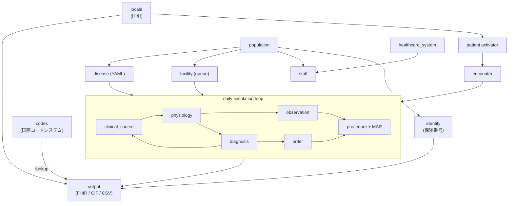

<!-- README.md から抽出 (Issue #568 PR A2)。本ファイルの見出しが変更されたら README のポインタを更新。 -->

# モジュール依存グラフ

主要モジュール間の概念的なデータフロー図。実際の import グラフではない:
モジュール同士が直接 import することは少なく、`clinosim/simulator/` が順に呼び出す。

`llm_service` と `validator` は cross-cutting (専用フェーズで使用)。
`identity` は既定で有効な enricher (AD-54。JP は `--no-jp-insurance` で
無効化でき、US は常に実行): enricher registry (AD-56) 経由
の post-population pass として走行、そのデータは `output` が FHIR
`Coverage` として emit。

詳細は各モジュールの `clinosim/modules/<module>/README.md` 参照。

---
