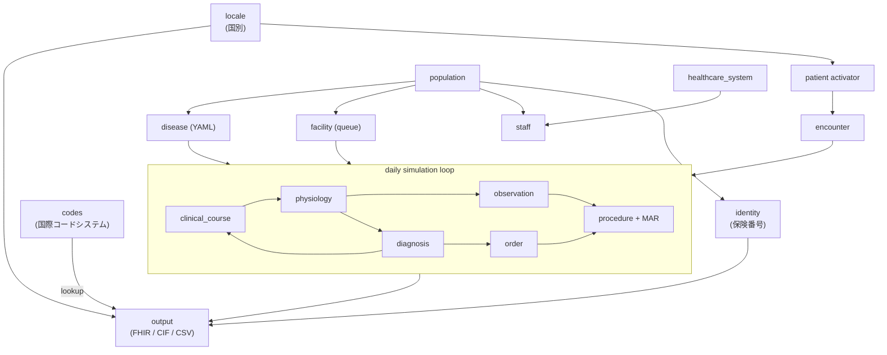

<!-- README.md から抽出 (Issue #568 PR A2)。本ファイルの見出しが変更されたら README のポインタを更新。 -->

# モジュール依存グラフ

主要モジュール間の概念的なデータフロー図。実際の import グラフではない:
モジュール同士が直接 import することは少なく、`clinosim/simulator/` が順に呼び出す。

`llm_service` と `validator` は cross-cutting (専用フェーズで使用)。
`identity` は既定で有効な enricher (AD-54。JP は `--no-jp-insurance` で
無効化でき、US は常に実行): enricher registry (AD-56) 経由
の post-population pass として走行、そのデータは `output` が FHIR
`Coverage` として emit。

詳細は各モジュールの `clinosim/modules/<module>/README.md` 参照。

## 検査される import の境界

実際の import グラフは 6 つの規則で保たれる。規則と例外は
[実装ルール §2.1](../design-guides/implementation-rules.ja.md#21-モジュール境界)
に記し、`tests/unit/test_module_boundaries.py` が数える:

1. 基盤パッケージ (`datafiles`、`determinism`、`seeding`、`age_bands`、
   `timeutil`、`reference_data`、`countries/__init__`、`country_profile`、
   `codes`、`locale`、`types`、`modules/_shared`) は、モジュール、シミュレータ、
   eval、audit を import しない;
2. ドメインモジュール (`clinosim/modules/<m>/`、`output` を除く) は
   `clinosim.simulator` を import しない;
3. どのパッケージも、別のパッケージの `_` で始まるモジュールや名前を import しない
   (例外: 式定数モジュール `_<topic>_thresholds` / `_<topic>_defaults`、
   `output/fhir_r4/builder.py` または `audit.py` が import する `_bb_*` バンドル
   ビルダー、`modules/_shared`);
4. `clinosim/modules/output/` は `clinosim.simulator` を import しない;
5. `clinosim/eval/` と `clinosim/audit/` は `clinosim.simulator` を import しない;
6. どのパッケージも、別のパッケージの `reference_data` ディレクトリへのパスを
   組み立てない。

既存の違反は規則ごとの合計として記録し、合計は減ってよいが増えてはならない。
`python -m tests.unit.module_boundaries --clusters 10` は、現在の合計と、規則ごとに
件数の多い `<import 元パッケージ> -> <対象>` のまとまりを表示する。

---
