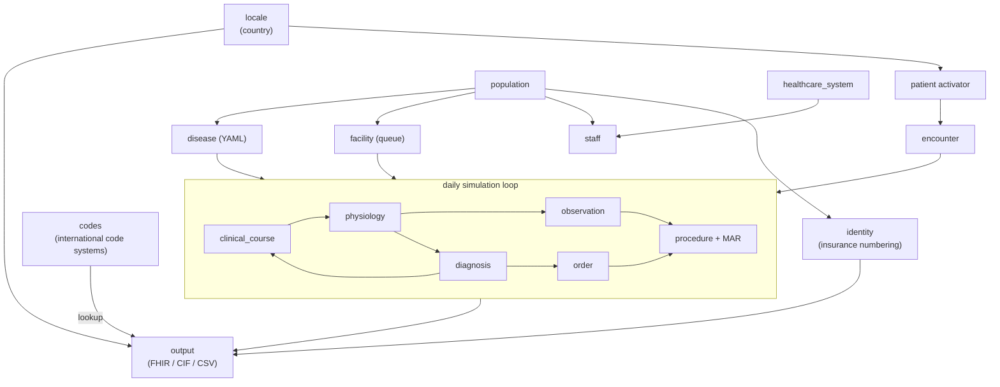

<!-- Extracted from `README.md` (Issue #568 PR A2). Update the pointer in README when this file's heading changes. -->

# Module Dependency Graph

Conceptual data-flow view of the main modules. It is not the literal import graph:
modules rarely import each other directly; `clinosim/simulator/` calls them in turn.

`llm_service` and `validator` are cross-cutting (used in dedicated phases).
`identity` is an enricher (AD-54) that is on by default (JP can opt out with
`--no-jp-insurance`; US always runs it): it runs as a post-population pass via the
enricher registry (AD-56) and its data is emitted as FHIR `Coverage` by `output`.

See each module's `clinosim/modules/<module>/README.md` for details.

## Enforced import boundaries

The literal import graph is held by six rules, stated with their exceptions in
[implementation-rules §2.1](../design-guides/implementation-rules.md#21-module-boundaries)
and counted by `tests/unit/test_module_boundaries.py`:

1. foundation packages (`datafiles`, `determinism`, `seeding`, `age_bands`,
   `timeutil`, `reference_data`, `countries/__init__`, `country_profile`,
   `codes`, `locale`, `types`, `modules/_shared`) do not import modules,
   the simulator, eval or audit;
2. a domain module (`clinosim/modules/<m>/`, except `output`) does not import
   `clinosim.simulator`;
3. no package imports a `_`-prefixed module or name of another package
   (exceptions: `_<topic>_thresholds` / `_<topic>_defaults` constant modules,
   `_bb_*` bundle builders imported by `output/fhir_r4/builder.py` or an
   `audit.py`, and `modules/_shared`);
4. `clinosim/modules/output/` does not import `clinosim.simulator`;
5. `clinosim/eval/` and `clinosim/audit/` do not import `clinosim.simulator`;
6. no package builds a path into another package's `reference_data` directory.

Existing violations are recorded as totals per rule; a total may fall but not
rise. `python -m tests.unit.module_boundaries --clusters 10` prints today's
totals and the largest `<importing package> -> <target>` clusters per rule.

---
